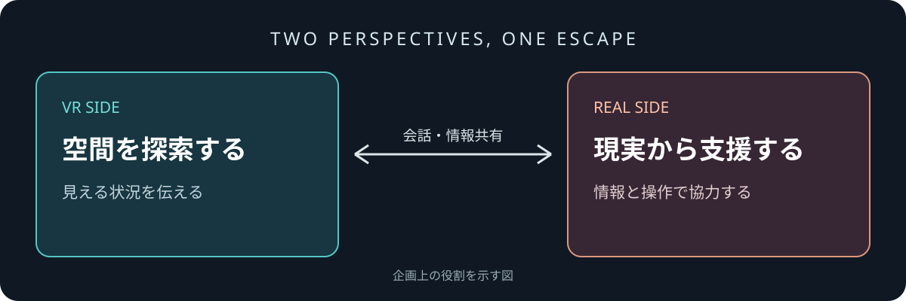
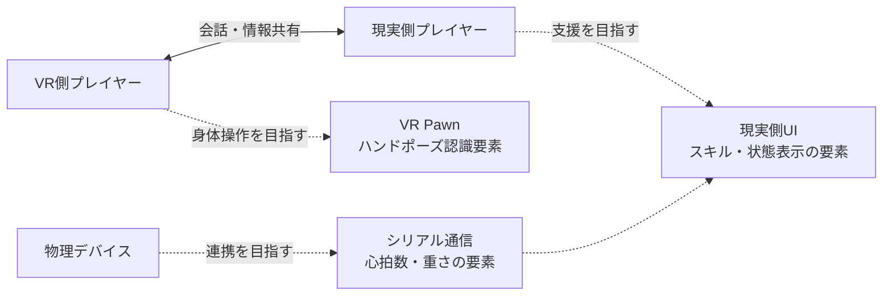

# PULSE

### ふたりの視点をつなぎ、恐怖の空間から脱出する。

**PULSE** は、VR空間を探索するプレイヤーと、現実側から支援するプレイヤーが協力する、2人用の非対称協力ホラーゲームです。一方が見ているものを、もう一方が操作できるとは限らない。離れた視点と情報を会話でつなぎ、脱出を目指します。

> **開発状況：** 本ページは企画意図とプロジェクトファイルから確認した開発内容を紹介しています。実機での一連の動作、仕様の完成度は確認中です。

## 目次

- [ふたりで挑むホラー体験](#ふたりで挑むホラー体験)
- [探索とギミック](#探索とギミック)
- [制作意図・実装紹介](#制作意図実装紹介)
- [技術的な特徴](#技術的な特徴)
- [開発環境](#開発環境)

## ふたりで挑むホラー体験

| | VR側 | 現実側 |
| --- | --- | --- |
| 役割 | VR空間を探索し、目の前の状況を相手に伝える | モニターや現実のデバイスを通じて情報を共有し、相手を支援する |
| 体験の狙い | 身体を使って不気味な空間に向き合う | 離れた視点から状況を読み、協力する |

コントローラーレスの身体操作を目指すのは、手元の操作機器を意識せず、VR空間への没入感を高めるためです。プロジェクトの `BP_VRPawn` には左右のハンドポーズ認識に関する要素があり、OpenXR Hand Trackingも有効です。一方、設定には `ControllersOnly` も残っているため、最終的な入力構成は実機での確認が必要です。

## 探索とギミック

VR側が探索し、現実側と情報を伝え合いながら脱出することを目指しています。プロジェクトにはタイルギミック、進行管理、鍵、ゲートなどの名前を持つBlueprintがあり、現実側UIにはライフ、心拍数、重さ、レーダーに関するWidgetがあります。各ギミックの正確なルールやゲーム全体の進行は確認中です。

### 物理デバイスとの連携

現実のセンサー操作をゲーム内の体験につなげる構想です。`BP_Serial` にはシリアルポートを開く処理や、心拍数・重さ・タイルに関する要素があり、シリアル通信プラグインもプロジェクトに含まれています。センサーの型番、配線、通信内容、実際のゲーム内反映は未検証です。

### 心拍数と恐怖

プレイヤーの状態をホラー演出に結びつけることを目指しています。心拍数の表示に関するWidgetと、`BP_Serial` 内の心拍数の取得・補正・高心拍状態に関する要素を確認しました。心拍数がどの演出やダメージに影響するかは、実機とBlueprintの詳細確認が必要です。

### 現実側のスキル

現実側がVR側を支える仕組みとして、`WBP_RealSideMain` に回復、シールド、レーダー、およびクールダウンに関する要素が存在します。効果、使用条件、操作方法と実際の動作は確認中です。

## 制作意図・実装紹介

VR側は目の前の恐怖と探索に集中し、現実側は異なる情報と操作から相手を支える。PULSEは、その分担によって「何を見ているか」「次に何をするか」を言葉で伝え合う協力体験を目指しています。

| 対象 | 制作・調査の着眼点 | 詳細 |
| --- | --- | --- |
| VR操作 | 両手のハンドポーズ認識を使った、身体感覚を重視する操作 | [Blueprint調査](docs/blueprints/overview.md#ハンドポーズによるvr操作--bp_vrpawn) |
| センサーと心拍数 | 現実の入力を、ゲーム側の情報やギミックに結び付ける | [Blueprint調査](docs/blueprints/overview.md#センサー情報--bp_serial) |
| 現実側の支援 | スキルや状態表示によって、探索中の相手を助ける | [Blueprint調査](docs/blueprints/overview.md#現実側の支援画面--wbp_realsidemain) |
| 現実側の表示 | Widgetを独立したウィンドウとして表示し、サブモニターを活用する | [C++の設計](docs/systems/real-side-window.md) |

Blueprint資料では、アセット内で確認した識別子と、ノード接続や実機動作の確認が必要な部分を区別しています。主要なBlueprintの実ファイルは [blueprints/PLUSE](blueprints/PLUSE) に収録しています。Unreal Engineのアセットであり、GitHub上ではノード構成を直接表示できません。元プロジェクトのマップ、他のアセット、プラグインは含まれないため、これらのファイルだけでは動作しません。

### C++：現実側ウィンドウ

`RealSideWindowSubsystem` は、Blueprintから指定したWidgetを別ウィンドウに表示し、サブモニターがあればその領域を利用します。重複表示の防止や終了時の後処理も実装しています。[実装の解説](docs/systems/real-side-window.md)と、元の [ヘッダー](code/RealSideWindowSubsystem/RealSideWindowSubsystem.h)・[ソース](code/RealSideWindowSubsystem/RealSideWindowSubsystem.cpp)を公開しています。単体ではビルドできず、Unreal Engineとプロジェクト側の依存関係が必要です。元ファイルのバイト列を保持しているため、日本語コメントはGitHub上で文字化けする場合があります。

## 技術的な特徴

- **VR入力：** `BP_VRPawn` に左右のハンドポーズ認識に関する要素があります。
- **デバイス連携：** `BP_Serial` にシリアル通信、心拍数、重さ、タイルに関する要素があります。機器との接続結果は未検証です。
- **現実側の表示：** C++の `RealSideWindowSubsystem` は指定されたWidgetを別ウィンドウで表示し、サブモニターがある場合はその作業領域に配置します。ゲーム中に呼び出される条件は未確認です。
- **UI：** 現実側メイン画面、心拍数、ライフ、重さ、レーダーなどに対応する名前のWidgetがあります。

図は企画上の役割と、ファイル内で確認できた要素をまとめたものです。点線は実機での接続・動作を保証するものではありません。

## 開発環境

| 項目 | 内容 |
| --- | --- |
| エンジン | Unreal Engine 5.5.4 |
| 実装 | Blueprint、C++ |
| VR関連 | OpenXR、OpenXR Hand Tracking。プロジェクト内にOculusHandToolsも存在 |
| デバイス連携 | SERIALCOMプラグイン。対応機器の詳細は確認中 |
| 主なマップ | `Lv_PLUSE`（プロジェクトのデフォルト設定） |

## 権利について

プロジェクトには第三者のアセットやプラグインが含まれます。このポートフォリオには公開許可を得た一部のBlueprintとC++コードを収録しています。ゲーム全体や参照先の外部アセット・プラグイン本体は収録していません。コード・資料を追加する際は、制作担当と再配布・公開条件を確認します。
